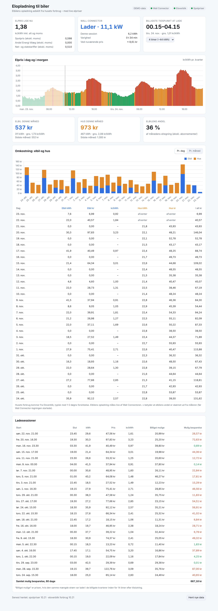

# Elopladning til biler

Se præcist hvad elbilen koster at lade – adskilt fra husets almindelige forbrug – beregnet med de rigtige variable elpriser kvarter for kvarter.

Appen kører på en computer derhjemme (fx en Raspberry Pi, en gammel PC eller en Mac), og du åbner dashboardet i browseren på telefonen eller computeren.



## Hvad den gør

| Data | Kilde |
|---|---|
| Elbilens opladning, live og præcist | **Tesla Wall Connector (Gen 3)** – lokalt API på hjemmenetværket |
| Husstandens samlede forbrug pr. kvarter | **Eloverblik.dk** (Energinet DataHub) |
| Nettarif, Energinets tariffer og elafgift for netop din adresse | **Eloverblik.dk** |
| Spotpriser (DK1/DK2) pr. kvarter, også for i morgen | **Energi Data Service** (Energinet) |
| Elselskabets tillæg (Andel Energi) | Du skriver det selv i `config.json` |

**Husets forbrug = elmålerens forbrug − Wall Connectorens forbrug**, beregnet for hvert kvarter. Prisen pr. kWh i et kvarter er:

```
(spotpris + Andel Energi-tillæg + nettarif + Energinet-tariffer + elafgift) × 1,25 moms
```

Dashboardet viser:

- elprisen lige nu og priskurven for i dag og i morgen
- om bilen lader, med hvor mange kW, og hvad sessionen koster
- det billigste tidspunkt at lade i de næste døgn
- kroner og kWh for elbil og hus pr. dag og pr. måned
- hver ladesession med pris og hvad den *kunne* have kostet, hvis den var ladet i de billigste kvarterer

For perioder **før** appen blev startet (hvor Wall Connectoren ikke er logget), skønner appen elbilens andel ud fra elmåleren: længere perioder med over 5 kW forbrug regnes som opladning. Disse tal er markeret med ≈.

## Kom i gang

### 1. Krav

- Python 3.9 eller nyere (ingen ekstra pakker – på Windows dog `pip install tzdata`)
- Computeren skal være på samme netværk som Wall Connectoren og stå tændt

### 2. Prøv demoen først

```bash
python3 -m elopladning --demo
```

Åbn http://localhost:8080. Demoen bruger opdigtede data.

### 3. Find Wall Connectorens IP-adresse

Se listen over tilsluttede enheder i din router (den hedder typisk noget med "TeslaWallConnector"). Test i browseren: `http://<ip>/api/1/vitals` skal vise en side med tal. Giv den gerne en fast IP-adresse i routeren.

### 4. Hent et token fra Eloverblik

1. Log ind på [eloverblik.dk](https://eloverblik.dk) med MitID.
2. Gå til **Datadeling** (eller "Del data") → **Opret token**, og kopier tokenet.

### 5. Find Andel Energis tillæg

Se din regning eller prisoversigten for dit produkt på Andel Energis hjemmeside. Tillægget står typisk i øre/kWh. Skriv det i kroner **uden moms** – fx 6 øre inkl. moms = `0.048`.

### 6. Udfyld config.json

```bash
cp config.example.json config.json
```

| Felt | Betydning |
|---|---|
| `wall_connector_host` | IP-adressen fra trin 3 |
| `eloverblik_refresh_token` | Tokenet fra trin 4 |
| `price_area` | `DK2` = Østdanmark (Sjælland, øerne og Bornholm), `DK1` = Jylland og Fyn |
| `supplier_addon_kr_per_kwh` | Tillæg fra trin 5, kr/kWh uden moms |
| `metering_point_id` | Tom = vælg automatisk dit forbrugsmålepunkt |
| `manual_tariffs` | Normalt `null`. Hvis Eloverblik ikke giver tariffer, kan de skrives ind: `{"net_hourly": [24 priser], "elafgift": 0.008, "systemtarif": 0.07}` |
| `history_days` | Hvor mange dages forbrug og priser der hentes første gang |

### 7. Start

```bash
python3 -m elopladning
```

Åbn `http://<computerens-ip>:8080` på telefonen, mens den er på hjemmenetværket.

Appen spørger Wall Connectoren hvert 30. sekund og henter priser og forbrug én gang i timen. Data gemmes i `elopladning.db`.

### Start automatisk (Raspberry Pi / Linux)

```ini
# /etc/systemd/system/elopladning.service
[Unit]
Description=Elopladning til biler
After=network-online.target

[Service]
WorkingDirectory=/home/pi/elopladning-til-biler
ExecStart=/usr/bin/python3 -m elopladning
Restart=always
User=pi

[Install]
WantedBy=multi-user.target
```

```bash
sudo systemctl enable --now elopladning
```

## Godt at vide

- **Eloverblik halter 1–2 døgn.** Husets forbrug for i dag og i går vises som "afventer". Elbilens opladning ses med det samme.
- **Abonnementer og faste gebyrer** (net- og elselskabsabonnement) er ikke med. Appen fordeler kun det, der betales pr. kWh.
- **Tarifferne** hentes én gang i døgnet. Ændrer netselskabet tarif (fx skift mellem sommer- og vintertarif), bruges den nye pris også bagud i tid, indtil den er hentet. Det giver kun en lille afvigelse.
- **Wall Connectoren** måler lidt anderledes end elmåleren. Hvis den måler mere end elmåleren i et kvarter, skaleres elbilen ned til målerens tal.
- **Til familie og venner:** hver husstand kører sin egen kopi med egen Wall Connector og eget Eloverblik-token. Ingen data forlader jeres hjemmenetværk ud over kaldene til Energinet.

## Test

```bash
python3 -m unittest discover tests
```

## Licens

Chart.js (MIT) er inkluderet i `static/vendor/`.
